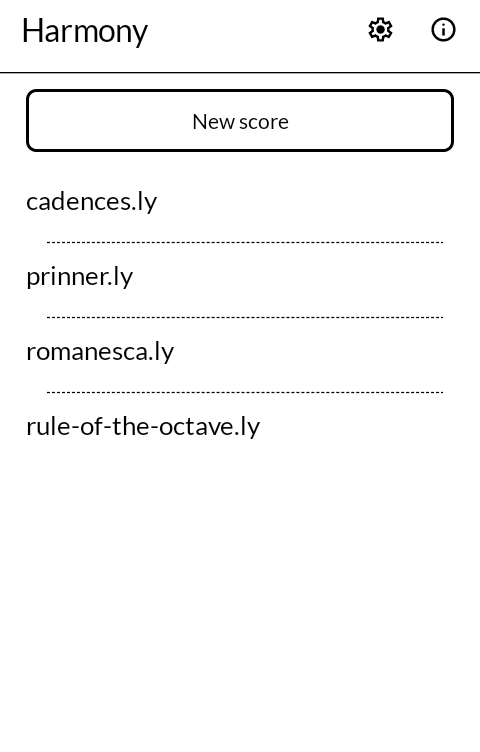
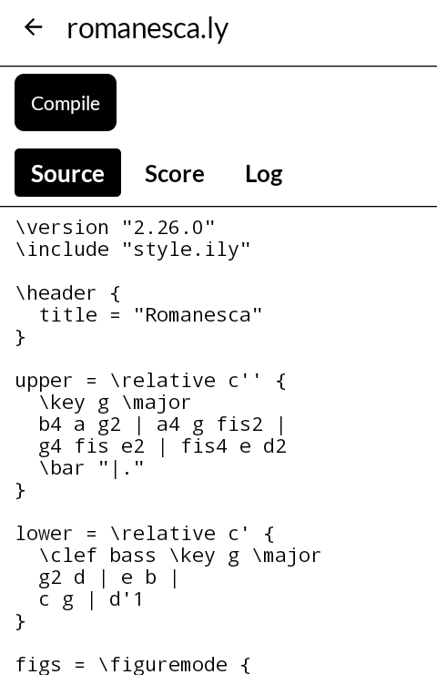
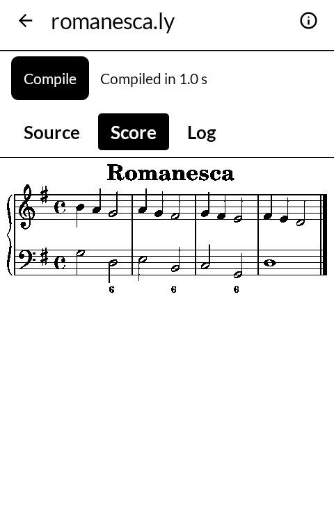
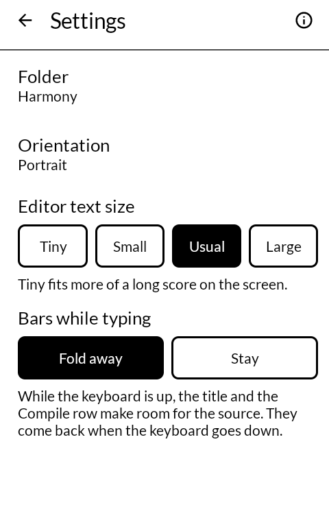

# 浄書 jōsho — Engraver

Type LilyPond, get an engraved score on the screen and a PDF beside the file. Runs LilyPond
2.26 itself, on the device, with no server and no internet permission. Made for the Mudita
Kompakt, and it will install on any Android 11 device; held sideways, the source and the score
sit side by side.

| | |
|---|---|
|  |  |
|  |  |

Pick a folder of `.ly` files (Cabinet's chooser when Cabinet is installed); `\include`s in that
folder are followed. A score that sets no paper size is engraved on A6, which fits the screen;
one with its own `\paper` size keeps it. Tap the engraved score to read it on the whole screen, and, when the
score has a `\midi` block, to hear it played by the phone's own synthesizer. See `SOURCES.md` for where every bundled binary comes
from and `build/` for how they are built.

The three dots in the editor's title bar hold Undo and Redo for the source, Save as, Delete,
Open in another app and Print (the last two for the engraved PDF). Hold a score in the list to
copy or delete it. Deleting a score takes the PDF and MIDI of the same name with it.

## What it does not do

No permissions: nothing is asked of you, and there is no `INTERNET` permission, so it cannot
open a network connection even by accident. The folder of scores is reached through the folder
you pick and nothing else. `PRIVACY.md` has the evidence.

## Building

```
./gradlew assembleArm64Debug
```

The bundled LilyPond is built separately first; `build/README.md` says how. A release build
needs a keystore at `signing/signing.keystore` with a matching `signing/signing.properties`.
There is no fallback key in this repository: without one, a release build comes out unsigned
rather than wrongly signed.

## Getting it, and keeping it

Download <https://github.com/wanderwildwood/josho/releases/latest/download/josho.apk>
and sideload it. That address always points at the newest release, and every release
publishes a `.sha256` beside the APK if you would rather check than trust.

For updates without doing this by hand, add this repository to
[Obtainium](https://github.com/ImranR98/Obtainium):

    https://github.com/wanderwildwood/josho

## Thanks

Thanks to [zyny](https://forum.mudita.com/u/zyny) on the Mudita forum, whose request started
this app.

## License

GPL-3.0-only. See [LICENSE](LICENSE).

Copyright (C) 2026 wander wildwood

This program is free software: you can redistribute it and/or modify it under the terms of the
GNU General Public License as published by the Free Software Foundation, version 3.

This program is distributed in the hope that it will be useful, but WITHOUT ANY WARRANTY;
without even the implied warranty of MERCHANTABILITY or FITNESS FOR A PARTICULAR PURPOSE. See the
GNU General Public License for more details.

You should have received a copy of the GNU General Public License along with this program. If
not, see <https://www.gnu.org/licenses/>.

LilyPond is GPL-3.0-or-later and most of its libraries are LGPL or permissive; their licenses
travel with them (see `SOURCES.md`). The fonts keep their own: Emmentaler under the SIL OFL 1.1,
TeX Gyre under the GUST Font License.
